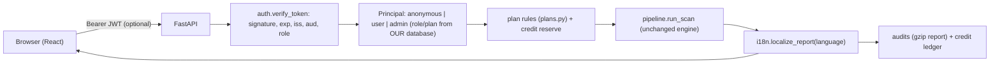

# Architecture

DataTrust Audit has **one** audit pipeline. Every frontend mode (single scan, deep scan, AI chat context, exports) consumes the same report.

```mermaid
flowchart LR
  U["POST /api/audit or /api/audit/deep"] --> V["url_guard: validation + DNS/SSRF"]
  V --> P["static_fetch: redirect pre-flight (each hop re-validated)"]
  P --> B["collector: Playwright, 3 isolated contexts"]
  B --> |"BASELINE / REJECT / ACCEPT"| N["normalize: raw capture to redacted Evidence"]
  B -. "browser failed" .-> S["static fallback (status = partial)"]
  S --> N
  N --> A["analyzers: tags, implementation, consent, events, privacy, policy"]
  A --> F["findings (OBSERVED / INFERRED / NOT_OBSERVED / UNVERIFIABLE)"]
  F --> SC["scoring (versioned, null when not measurable)"]
  SC --> R["report JSON (+ stages, limitations, evidence)"]
  R -. "optional, never detection" .-> RAG["RAG explanations with citations"]
  R -. "confirmed context only" .-> CHAT["grounded assistant"]
```

## Modules (`datatrust/`)

| Module | Responsibility |
|---|---|
| `url_guard.py` | URL validation, hostname deny-list, DNS resolution (all records must be public), Chromium IP pinning, per-request `RequestGuard`. |
| `static_fetch.py` | SSRF-safe HTTP fetch with manual redirect following; used for pre-flight and static fallback. |
| `collector.py` | Playwright collector. One browser per scan; **a fresh context per phase/page**. Non-invasive hooks (dataLayer polling, `fbq` Proxy). CMP interaction with verification. |
| `cmp_adapters.py` | Cookiebot, OneTrust, Didomi, Usercentrics, CookieYes, iubenda, Complianz, AdOpt adapters + strict generic text matcher. |
| `normalize.py` | The only code that reads raw captures. Produces `Evidence` objects; redacts URLs/bodies/storage; never stores cookie/storage values. |
| `catalog.py` | 43 vendors. Signature classes: `beacon` (collection request), `script` (library loaded), `html` (code signature), `globals`. |
| `analyzers.py` | Evidence → tags + findings. |
| `ga4_spec.py` | GA4 recommended-event requirements (official reference). |
| `scoring.py` | Versioned scoring (see `SCORING.md`). |
| `crawler.py` | Deep-scan page selection from links actually present in the DOM. |
| `pipeline.py` | Orchestration, stage telemetry, status, report assembly. |
| `rag/` | Official-source corpus + BM25 retrieval + explanations with citations. |
| `assistant.py` | Chat grounded on the report; deterministic fallback; post-check against legal conclusions / monetary estimates. |

## API (`api/audit.py`)

| Endpoint | Purpose |
|---|---|
| `POST /api/audit` | `{url, consent_phases=true, explain=false}` single-page scan |
| `POST /api/audit/deep` | `{url, max_pages≤10}` home (with consent phases) + same-origin pages (baseline) |
| `GET /api/methodology` | weights, catalog, statuses, limitations |
| `POST /api/explain` | `{findings}` → explanations with citations (or `insufficient_sources`) |
| `POST /api/chat` | `{message, report}` grounded assistant |
| `GET /health` | engine/scoring versions, browser, RAG corpus, frontend build |

No authentication, plan or database is involved in scanning or reading results. Abuse protection: per-IP rate limit (`DATATRUST_RATE_LIMIT_SCANS` per `DATATRUST_RATE_WINDOW_S`) and a concurrency semaphore (`DATATRUST_MAX_CONCURRENT_SCANS`).

## Scan statuses

`completed` · `partial` (any phase/page degraded, or static fallback) · `blocked` (target/redirect disallowed by SSRF policy) · `timeout` · `protocol_error` · `failed`.

## Stage telemetry

Each report contains `stages[]` with name, status, duration and error: `url_validation_dns_ssrf`, `redirect_preflight`, `browser_launch`, `navigation_baseline`, `consent_reject`, `consent_accept`, `deep_page`, `static_fallback`, `evidence_normalization`, `analysis`, `scoring`, `rag_enrichment`, `response`. Logs contain scan id + stage + status only (no URLs with query strings, no PII).

## Frontend (`static/`)

React/Vite SPA. Served by Vite in development (`npm run dev`, port 8080, proxy `/api` → 8000) or from `static/dist` by FastAPI in production. Components live in `static/src/components/audit/` and render the report as-is (no client-side scoring, no fallbacks that fabricate values).

## What was removed

The legacy second engine in `main.py` (`/analyze`, `/deep-analyze`, `/export/*`, `/chat`, `generate_audit_report`), `audit_engine/` (fine tables, cookie inference, HTML-position consent), auth/payments/scans/exports routers, SQLite DB, Celery worker, Supabase/Kiwify frontend flows, plan gating, and all frontend services that simulated data. Everything is recoverable from branch `backup/pre-evidence-first-2026-10-25`.

## Accounts, plans and history (added 2026-10-27)

| Module | Responsibility |
|---|---|
| `datatrust/auth.py` | Supabase JWT verification (HS256 secret / ES256-RS256 JWKS), principals, `require_user`, `require_admin`, admin-only plan simulation header |
| `datatrust/plans.py` | **single source** of plans, quotas, features; `implemented=false` features are listed but never enforced |
| `datatrust/accounts.py` | profiles, effective plan, atomic + idempotent credits, role changes, admin log |
| `datatrust/db.py`, `models.py`, `migrations/` | SQLAlchemy engine (SQLite dev / PostgreSQL prod), versioned SQL migrations |
| `datatrust/repository.py` | audit persistence (stored canonical, re-localized on read), interrupted-audit recovery |
| `datatrust/plan_tests.py` | isolated, real rule tests for a plan ("Testar permissões e limites") |
| `datatrust/i18n/` | `rulebook.py` (rule code → pt-BR/en text, owner, how to confirm), `messages.py` (static engine messages), `events.py` (event glossary), `localize_report` |
| `datatrust/contract.py` | versioned report contract (pydantic) |
| `api/accounts.py`, `api/admin.py` | `/api/me`, `/api/plans`, `/api/audits*`, `/api/admin/*` |

**Language contract:** the engine emits stable rule codes + data + evidence ids. Human text is rendered by `localize_report` in the requested language (`language` field/query). Technical identifiers (rule ids, event names, IDs, URLs, parameters) are never translated; untranslated engine strings are listed in `report.i18n.untranslated` instead of leaking English silently.

**Frontend routes:** `/` (public scanner), `/auth`, `/auth/callback`, `/app`, `/auditorias/:id`, `/configuracoes`, `/admin`. One language source (`context/I18nContext.tsx`, dictionaries in `src/i18n/*.json`, parity enforced by `tests/test_i18n_parity.py`).

**Audits run inside the request** (no job queue yet). A server restart marks audits still `running` as `failed (INTERRUPTED)` and releases their credit. Persistent jobs/worker/cancellation are Stage 3.
